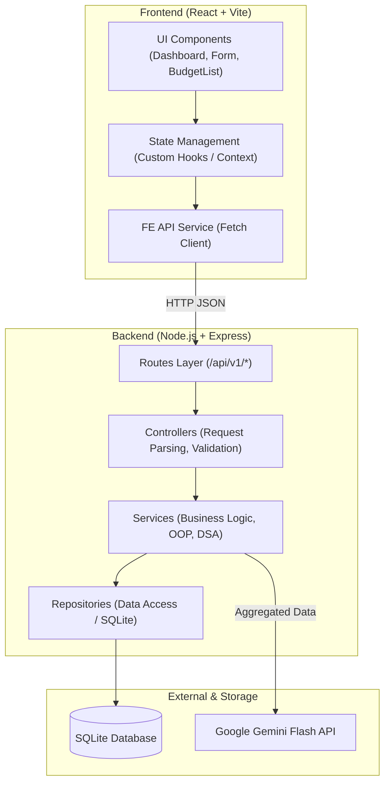
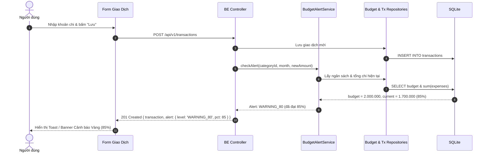
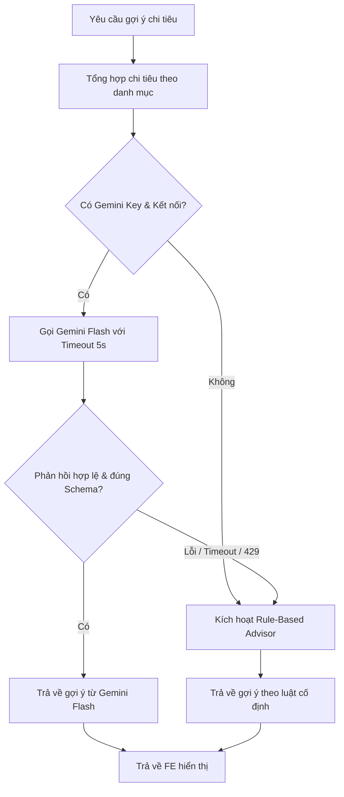

# SPEC 02: Kiến Trúc Hệ Thống (Architecture)

## 1. Mô hình Phân tầng (Layered Architecture)

Hệ thống tuân thủ nghiêm ngặt nguyên tắc phân tầng và đảo ngược phụ thuộc (Dependency Injection):

---

## 2. Phân công Trách nhiệm Từng Tầng

### 2.1 Backend
- **Route**: Định nghĩa endpoint URL, HTTP methods, và gắn middleware xác thực input.
- **Controller**: Trích xuất `req.body`, `req.query`, thực thi schema validation (Zod), gọi Service tương ứng và định dạng response HTTP (200, 201, 400, 500).
- **Service**:
  - Chứa 100% logic nghiệp vụ, tính toán cảnh báo ngân sách (`BudgetAlertService`), áp dụng cấu trúc dữ liệu (`AnalyticsService`), tích hợp AI & Fallback (`AiAdvisorService`).
  - Các dependency (Repo, AI Client) được truyền vào qua constructor (Dependency Injection).
- **Repository**: Thực thi các câu lệnh SQL trên SQLite, ánh xạ dữ liệu bảng thành đối tượng Domain.

### 2.2 Frontend
- **Components**: Chỉ đảm nhiệm hiển thị và nhận tương tác từ người dùng (dumb components & container components).
- **State Layer**: Lưu trữ danh sách giao dịch, ngân sách, cảnh báo vừa phát sinh, và kết quả gợi ý AI.
- **Service Layer**: Đóng gói các hàm gọi `fetch`, xử lý HTTP header, serialize query params, bắt lỗi mạng.

---

## 3. Luồng Xử lý Cảnh Báo Tức Thời (Instant Alert Flow)

Khi người dùng ghi nhận một khoản chi mới, hệ thống tính toán và phản hồi cảnh báo ngay trong kết quả của request tạo giao dịch:

---

## 4. Luồng Dự Phòng AI (Gemini + Rule-Based Fallback)

Đảm bảo hệ thống không gián đoạn khi AI gặp sự cố:

