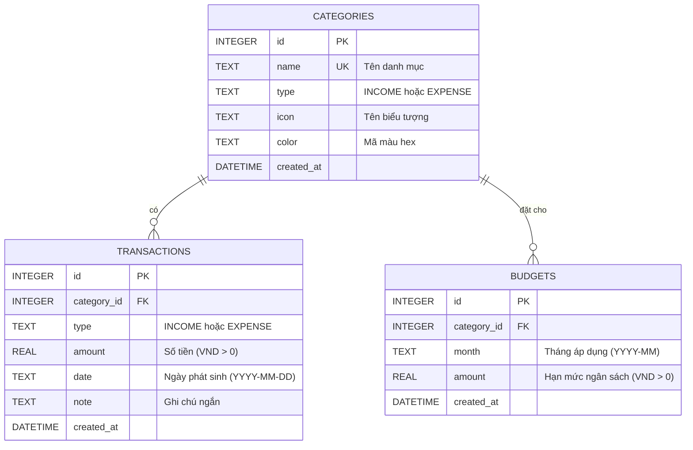

# SPEC 03: Mô Hình Dữ Liệu (Data Model)

## 1. Sơ đồ Thực thể Cơ sở Dữ liệu (SQLite)



---

## 2. Chi Tiết Bảng Dữ Liệu & Ràng Buộc (DDL)

```sql
-- 1. Bảng Danh mục
CREATE TABLE IF NOT EXISTS categories (
    id INTEGER PRIMARY KEY AUTOINCREMENT,
    name TEXT NOT NULL UNIQUE,
    type TEXT NOT NULL CHECK(type IN ('INCOME', 'EXPENSE')),
    icon TEXT DEFAULT 'tag',
    color TEXT DEFAULT '#3B82F6',
    created_at DATETIME DEFAULT CURRENT_TIMESTAMP
);

-- 2. Bảng Giao dịch (Thu/Chi)
CREATE TABLE IF NOT EXISTS transactions (
    id INTEGER PRIMARY KEY AUTOINCREMENT,
    category_id INTEGER NOT NULL REFERENCES categories(id) ON DELETE RESTRICT,
    type TEXT NOT NULL CHECK(type IN ('INCOME', 'EXPENSE')),
    amount REAL NOT NULL CHECK(amount > 0),
    date TEXT NOT NULL, -- Định dạng YYYY-MM-DD
    note TEXT,
    created_at DATETIME DEFAULT CURRENT_TIMESTAMP
);

-- Index hỗ trợ tìm kiếm nhị phân / range query theo ngày
CREATE INDEX IF NOT EXISTS idx_transactions_date ON transactions(date);
CREATE INDEX IF NOT EXISTS idx_transactions_category ON transactions(category_id);

-- 3. Bảng Ngân sách theo tháng
CREATE TABLE IF NOT EXISTS budgets (
    id INTEGER PRIMARY KEY AUTOINCREMENT,
    category_id INTEGER NOT NULL REFERENCES categories(id) ON DELETE CASCADE,
    month TEXT NOT NULL, -- Định dạng YYYY-MM
    amount REAL NOT NULL CHECK(amount > 0),
    created_at DATETIME DEFAULT CURRENT_TIMESTAMP,
    UNIQUE(category_id, month) -- Mỗi danh mục chỉ có 1 hạn mức trong 1 tháng
);

CREATE INDEX IF NOT EXISTS idx_budgets_month ON budgets(month);
```

---

## 3. Dữ Liệu Khởi Tạo Mẫu (Seed Data)

### Danh mục Chi tiêu (EXPENSE):
- Ăn uống (`icon`: `utensils`, `color`: `#EF4444`)
- Tiền thuê nhà & Sinh hoạt (`icon`: `home`, `color`: `#F59E0B`)
- Đi lại & Xăng xe (`icon`: `car`, `color`: `#10B981`)
- Mua sắm (`icon`: `shopping-bag`, `color`: `#8B5CF6`)
- Giải trí & Bạn bè (`icon`: `film`, `color`: `#EC4899`)
- Y tế & Sức khỏe (`icon`: `heart-pulse`, `color`: `#06B6D4`)
- Hóa đơn & Tiện ích (`icon`: `receipt`, `color`: `#6B7280`)

### Danh mục Thu nhập (INCOME):
- Lương chính (`icon`: `wallet`, `color`: `#10B981`)
- Thưởng & Làm thêm (`icon`: `gift`, `color`: `#3B82F6`)
- Đầu tư / Tiết kiệm (`icon`: `trending-up`, `color`: `#6366F1`)
- Thu nhập khác (`icon`: `plus-circle`, `color`: `#9CA3AF`)

---

## 4. Schemas Validation (Zod DTOs)

### 4.1 Transaction DTO
```javascript
const CreateTransactionSchema = z.object({
  category_id: z.number().int().positive(),
  type: z.enum(['INCOME', 'EXPENSE']),
  amount: z.number().positive(),
  date: z.string().regex(/^\d{4}-\d{2}-\d{2}$/, 'Định dạng ngày phải là YYYY-MM-DD'),
  note: z.string().max(255).optional()
});
```

### 4.2 Budget DTO
```javascript
const SetBudgetSchema = z.object({
  category_id: z.number().int().positive(),
  month: z.string().regex(/^\d{4}-\d{2}$/, 'Định dạng tháng phải là YYYY-MM'),
  amount: z.number().positive()
});
```
