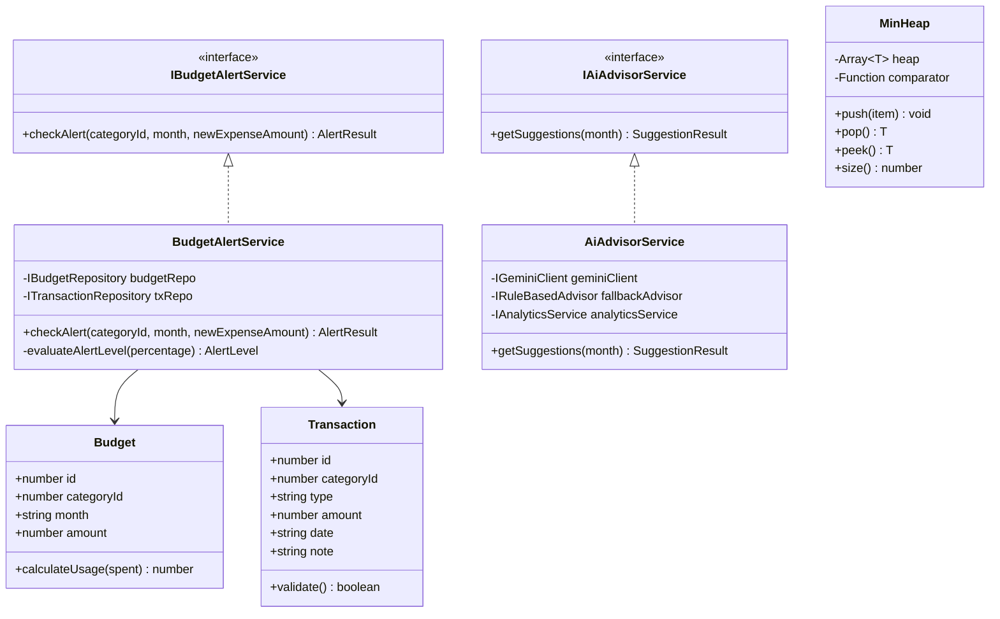

# SPEC 07: Cấu Trúc Dữ Liệu & Hướng Đối Tượng (DSA & OOP)

## 1. Thiết Kế Hướng Đối Tượng (OOP Principles)

Tuân thủ nguyên tắc **Trách nhiệm Đơn lẻ (Single Responsibility Principle - SRP)** và **Đảo ngược Phụ thuộc (Dependency Inversion)**. Mọi phụ thuộc đều được tiêm qua `constructor`.

### 1.1 Sơ đồ Lớp (Class Diagram)



### 1.2 Chi Tiết Các Lớp & Trách Nhiệm

1. **`BudgetAlertService`**:
   - **Trách nhiệm duy nhất**: Xác định mức cảnh báo ngân sách (`NONE`, `WARNING_80`, `EXCEEDED_100`) dựa trên tổng chi tiêu hiện tại cộng với khoản chi mới.
   - **Constructor**:
     ```javascript
     constructor(budgetRepository, transactionRepository) {
       this.budgetRepo = budgetRepository;
       this.txRepo = transactionRepository;
     }
     ```
   - **Hàm `checkAlert(categoryId, month, newAmount)`**: Lấy hạn mức, lấy tổng đã chi, tính `% = (currentSpent + newAmount) / budgetAmount * 100`, trả về DTO chuẩn.

2. **`AiAdvisorService`**:
   - **Trách nhiệm duy nhất**: Điều phối luồng sinh gợi ý chi tiêu (chuẩn bị dữ liệu tổng hợp $\rightarrow$ gọi Gemini Flash $\rightarrow$ nếu lỗi thì chuyển sang `RuleBasedAdvisor`).
   - **Constructor**:
     ```javascript
     constructor(geminiClient, fallbackAdvisor, analyticsService) {
       this.geminiClient = geminiClient;
       this.fallbackAdvisor = fallbackAdvisor;
       this.analyticsService = analyticsService;
     }
     ```

3. **`RuleBasedAdvisor`**:
   - **Trách nhiệm duy nhất**: Sinh gợi ý dựa trên tập luật cố định với số liệu tính toán chính xác khi AI vắng mặt.

---

## 2. Cấu Trúc Dữ Liệu & Giải Thuật (DSA)

| Bài toán | Cấu trúc dữ liệu chọn | Thời gian (Time) | Không gian (Space) | Lý do lựa chọn & So sánh |
|---|---|---|---|---|
| **1. Gom tổng chi theo danh mục** | `Map<categoryId, Summary>` | $O(n)$ | $O(k)$ | Tra cứu và cộng dồn bằng Hash Map với chi phí $O(1)$ mỗi phần tử. Duyệt qua $n$ giao dịch đúng 1 vòng lặp. $k$ là số lượng danh mục ($k \le n$). |
| **2. Lấy Top-K khoản chi lớn nhất** | `Min-Heap` (Priority Queue) | $O(n \log k)$ | $O(k)$ | Thay vì sắp xếp toàn bộ $n$ phần tử ($O(n \log n)$), duy trì Min-Heap kích thước $k=5$. Với mỗi phần tử, so sánh với đỉnh heap ($O(1)$), nếu lớn hơn thì pop và push ($O(\log k)$). Rất nhanh khi $n$ lớn và $k$ nhỏ. |
| **3. Lọc giao dịch theo khoảng ngày** | Mảng đã sắp xếp + Binary Search | $O(\log n + m)$ | $O(1)$ phụ trợ | Tìm biên trái `startDate` (`lowerBound`) và biên phải `endDate` (`upperBound`) bằng tìm kiếm nhị phân trong $O(\log n)$, sau đó trích xuất $m$ phần tử trong khoảng. Nhanh hơn duyệt toàn bộ $O(n)$ khi số lượng giao dịch tăng cao. |

---

## 3. Mã Giả & Thiết Kế Cài Đặt DSA

### 3.1 Min-Heap cho Top-K Chi Tiêu
```javascript
class MinHeap {
  constructor(comparator = (a, b) => a - b) {
    this.data = [];
    this.comparator = comparator;
  }
  // push: thêm và sàng lên O(log k)
  // pop: lấy đỉnh và sàng xuống O(log k)
  // peek: xem đỉnh O(1)
}

function findTopKExpenses(transactions, k = 5) {
  const heap = new MinHeap((a, b) => a.amount - b.amount);
  for (const tx of transactions) {
    if (tx.type !== 'EXPENSE') continue;
    if (heap.size() < k) {
      heap.push(tx);
    } else if (tx.amount > heap.peek().amount) {
      heap.pop();
      heap.push(tx);
    }
  }
  return heap.data.sort((a, b) => b.amount - a.amount);
}
```

### 3.2 Binary Search Lọc Khoảng Ngày
```javascript
function findDateRangeIndices(sortedTransactions, startDate, endDate) {
  // lowerBound: vị trí đầu tiên có date >= startDate
  let left = 0, right = sortedTransactions.length;
  while (left < right) {
    const mid = Math.floor((left + right) / 2);
    if (sortedTransactions[mid].date >= startDate) right = mid;
    else left = mid + 1;
  }
  const startIndex = left;

  // upperBound: vị trí đầu tiên có date > endDate
  left = 0; right = sortedTransactions.length;
  while (left < right) {
    const mid = Math.floor((left + right) / 2);
    if (sortedTransactions[mid].date > endDate) right = mid;
    else left = mid + 1;
  }
  const endIndex = left;

  return sortedTransactions.slice(startIndex, endIndex);
}
```

---

## 4. Kế Hoạch Kiểm Thử Tự Động (Unit Testing)

Tất cả các hàm logic nghiệp vụ và thuật toán phải có unit test độc lập:

### 4.1 Test Matrix cho `BudgetAlertService`
1. `should return NONE when spending is below 80%`:
   - Ngân sách: 2.000.000 ₫, Hiện tại: 1.000.000 ₫, Thêm: 200.000 ₫ $\rightarrow$ 60% $\rightarrow$ `NONE`.
2. `should return WARNING_80 when spending hits exactly 80%`:
   - Ngân sách: 2.000.000 ₫, Hiện tại: 1.400.000 ₫, Thêm: 200.000 ₫ $\rightarrow$ 80% $\rightarrow$ `WARNING_80`.
3. `should return WARNING_80 when spending is between 80% and 99.9%`:
   - Ngân sách: 2.000.000 ₫, Hiện tại: 1.500.000 ₫, Thêm: 400.000 ₫ $\rightarrow$ 95% $\rightarrow$ `WARNING_80`.
4. `should return EXCEEDED_100 when spending hits or exceeds 100%`:
   - Ngân sách: 2.000.000 ₫, Hiện tại: 1.800.000 ₫, Thêm: 400.000 ₫ $\rightarrow$ 110% $\rightarrow$ `EXCEEDED_100`.
5. `should return NONE when category has no budget set`:
   - Không tìm thấy budget trong DB $\rightarrow$ trả về `NONE`.

### 4.2 Test Matrix cho DSA
1. **MinHeap**:
   - Thêm vào $N < K$ phần tử $\rightarrow$ trả về đúng tất cả các phần tử.
   - Thêm vào mảng lớn với các giá trị ngẫu nhiên $\rightarrow$ trả về đúng top-5 phần tử lớn nhất.
2. **Binary Search Date Range**:
   - Tìm kiếm với khoảng ngày nằm trọn vẹn trong danh sách.
   - Tìm kiếm với khoảng ngày không có giao dịch nào phát sinh $\rightarrow$ mảng rỗng.
   - Tìm kiếm với ngày ngoài biên (nhỏ hơn ngày nhỏ nhất hoặc lớn hơn ngày lớn nhất).
3. **Map Aggregation**:
   - Tính tổng chính xác trên nhiều giao dịch thuộc cùng 1 danh mục.
   - Bỏ qua giao dịch không cùng loại (ví dụ tính tổng chi thì bỏ qua thu nhập).
