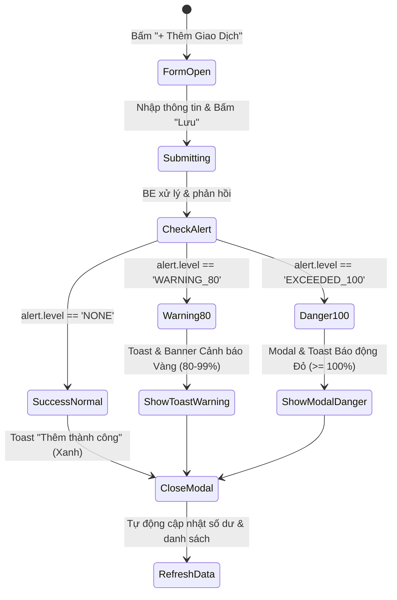

# SPEC 05: Luồng Giao Diện Người Dùng (UI Flow & Wireframe)

## 1. Bố Cục Ứng Dụng (Application Layout)

Giao diện dạng Single Page Application (SPA), gồm thanh điều hướng trên cùng, bộ chọn tháng toàn cục, và khu vực nội dung chính:

```
+-----------------------------------------------------------------------------------+
|  [Logo] SmartFinance VND      [Tháng: < 2026-10 >]    [Số dư: +8.600.000 ₫]       |
+-----------------------------------------------------------------------------------+
|  [Tab: Dashboard]  |  [Tab: Giao dịch]  |  [Tab: Ngân sách]  |  [Tab: Gợi ý AI]   |
+-----------------------------------------------------------------------------------+
|                                                                                   |
|                                 [NỘI DUNG THEO TAB]                               |
|                                                                                   |
+-----------------------------------------------------------------------------------+
```

---

## 2. Luồng Màn Hình Chi Tiết

### 2.1 Tab 1: Dashboard (Tổng quan & Biểu đồ)
- **Top Metrics**: 3 thẻ lớn:
  - **Tổng Thu**: `+25.000.000 ₫` (màu xanh lá)
  - **Tổng Chi**: `-16.400.000 ₫` (màu đỏ)
  - **Số Dư Ròng**: `+8.600.000 ₫` (màu xanh dương đậm)
- **Khu vực Biểu đồ**:
  - *Bên trái*: Biểu đồ Donut tỷ trọng chi tiêu theo danh mục (Ăn uống, Thuê nhà, Đi lại,...).
  - *Bên phải*: Biểu đồ cột Xu hướng Thu vs Chi 6 tháng gần nhất.
- **Top 5 Khoản Chi Lớn Nhất**: Danh sách hiển thị ngay trên Dashboard (truy vấn nhanh qua Min-Heap BE).
- **Nút hành động nhanh**: Nút tròn "+ Thêm Giao Dịch" mở Modal nhập nhanh.

---

### 2.2 Tab 2: Quản Lý Giao Dịch & Luồng Cảnh Báo Ngân Sách Tức Thì

#### Sơ đồ tương tác cảnh báo:


- **Thành phần Bộ lọc Giao dịch**:
  - Lọc theo loại (Tất cả / Thu / Chi).
  - Lọc theo Danh mục (Dropdown).
  - Lọc theo Khoảng ngày (Từ ngày `startDate` đến ngày `endDate` - xử lý bằng Binary Search tại BE).
- **Bảng dữ liệu**: Có nút Chỉnh sửa và Xóa trên từng dòng kèm xác nhận.

---

### 2.3 Tab 3: Thiết Lập & Theo Dõi Ngân Sách (Budgets)
- Hiển thị danh sách các danh mục chi tiêu kèm thanh tiến độ trực quan:
  - **Dưới 80%**: Thanh màu xanh lá mạ `[========            ] 45% (900.000 / 2.000.000 ₫)`.
  - **Từ 80% đến 99%**: Thanh màu vàng hổ phách kèm badge `85% - Sắp chạm hạn mức!`.
  - **Từ 100% trở lên**: Thanh màu đỏ rực kèm icon cảnh báo `115% - ĐÃ VƯỢT HẠN MỨC!`.
- Modal "Đặt hạn mức ngân sách": Chọn danh mục, nhập số tiền VND, bấm lưu (hỗ trợ upsert tự động).

---

### 2.4 Tab 4: Trợ Lý Gợi Ý Chi Tiêu (AI Advisor)
- **Header**:
  - Nút bấm `[ ✨ Phân Tích Bằng Gemini Flash ]`.
  - Badge trạng thái: 
    - `Xanh (Gemini Flash AI)` khi kết nối thành công.
    - `Cam (Quy Tắc Dự Phòng)` khi mất mạng hoặc không có API key.
- **Thẻ tóm tắt tổng quan**: Đánh giá ngắn gọn sức khỏe tài chính tháng đang chọn.
- **Danh sách $\le 5$ thẻ gợi ý chi tiêu cụ thể**:
  - Mỗi thẻ hiển thị:
    - Loại gợi ý (Cắt giảm, Tiết kiệm, Cảnh báo).
    - Danh mục liên quan.
    - Con số mục tiêu cụ thể (Ví dụ: "Giảm 300.000 ₫", "Hạn mức tối đa 50.000 ₫/ngày").
    - Hành động gợi ý thực tế.
